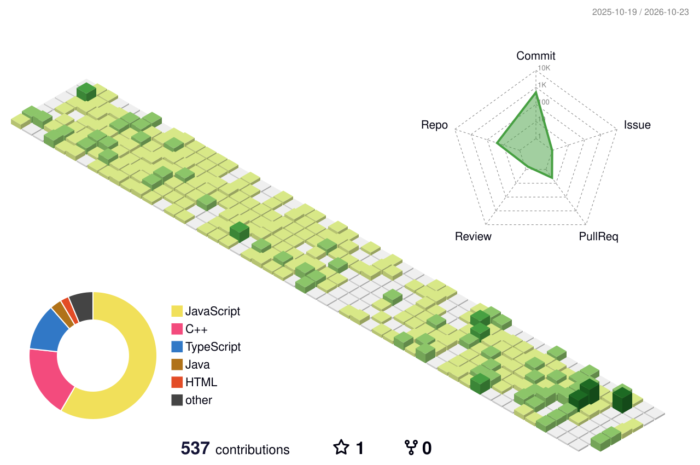

 

> Hey, I'm **Pranshul** — an **MCA student (2025–2027)** at **Geeta University, Panipat** and **1st Semester Topper (SGPA 9.33 | CGPA ~9.20)**.
> I build full-stack products with the **MERN stack** and ship **AI-powered features** (Gemini, agentic workflows, LLMs) as a core part of the architecture — not as a gimmick.
> Currently targeting **SDE roles**.

> - 🏆 Building **GTECH Code** — a LeetCode-style online judge (MERN + Redis + Judge0 + Gemini)
> - 🤖 Agentic AI systems — multi-agent backends, chatbots, AI hints & explanations
> - 🤝 **Co-Founder @ GenBots** — STEM robotics / IoT startup (thegenbots.in)
> - 🎓 **Lead Organizer** of tech events & hackathons (SCSE, Geeta University) • Class Representative • Student Mentor
> - 🧠 **330+ DSA problems** solved on LeetCode & GeeksforGeeks
> - 🌱 Learning **system design, backend performance & API security**

> Ship real products, solve real problems, and grow into an engineer who builds **scalable production systems that thoughtfully integrate AI**.
> **Consistency + Curiosity + Clean Code + AI = Great Software.**

> Organizing hackathons, mentoring juniors, and building communities around tech. Always up for collabs on impactful **AI + software** projects.

 

<table>
  <tr>
    <th>LinkedIn</th>
    <th>GitHub</th>
    <th>Gmail</th>
    <th>Website</th>
    <th>LeetCode</th>
  </tr>
  <tr align="center">
    <td></td>
    <td></td>
    <td></td>
    <td></td>
    <td></td>
  </tr>
</table>

 

<picture>
  <source media="(prefers-color-scheme: dark)" srcset="./profile-3d-contrib/profile-night-green.svg">
  
</picture>

 

 

 

  

### 🏆 GTECH Code — AI-Powered Online Judge
> My flagship project, built during my **SVS Techforge** internship. A LeetCode-style competitive coding platform.
> - ⚙️ **Stack:** MERN • Redis • Judge0 API • Gemini AI
> - 🧪 Real-time code execution & judging with async polling and queueing
> - 🤖 AI-generated hints and explanations powered by Gemini
> - 🔐 Custom authentication built from scratch
>
> 

### 🕉️ SAJSSM — Web Platform & "Nandi" AI Chatbot
> Built for **Shri Amarnath JanShakti Sewa Mandal**, a non-profit running langar seva at the Amarnath Yatra.
> - 🤖 Multi-agent AI CLI backend (Node.js + Gemini) — weather, crypto, GitHub & news agents
> - 💬 **"Nandi"** — agentic chatbot with quick-reply chips and custom branded UI

### 🤖 GenBots — STEM Robotics & IoT Startup
> Co-founding **GenBots** (thegenbots.in), a Sonipat-based MSME startup bringing robotics and IoT learning to students.

 

`Arrays & Strings` • `Linked Lists` • `Recursion` • `Trees & Graphs` • `DP` • `Sliding Window` • `Greedy` • `Backtracking`

  

 

  

⭐ **Always open to learning opportunities, collaboration, and impactful AI + software projects.**

